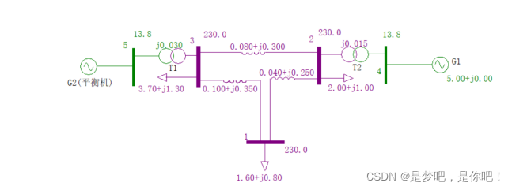
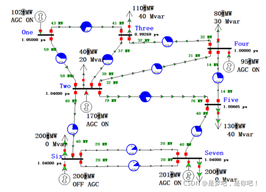
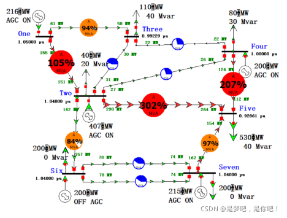
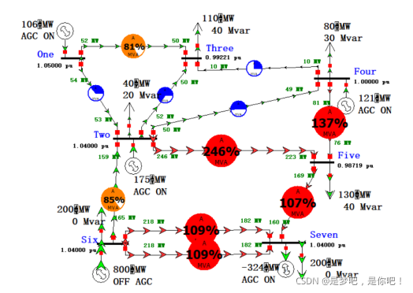
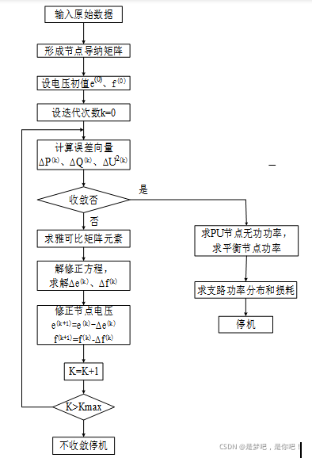
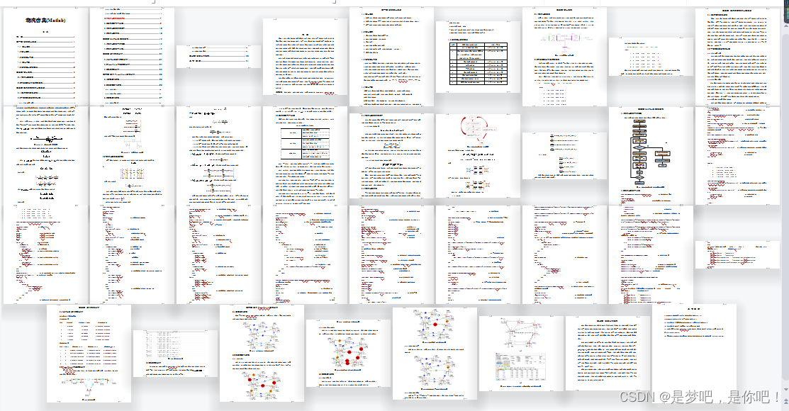

# Trend Simulation (Matlab and PowerWord)

Contents
1. Overview
2 Main Tasks
3 Main Content
4 Case Analysis
5 PowerWorld simulation
5.1 Normal operation
5.2 Load increase
5.3 Increase in generator output
6 MATLAB programming examples
6.1 Flowchart of the current calculation program
6.2 Flow Calculation Code
1. Overview - initially, The power system flow calculation is conducted manually. Later on, in order to adapt to the needs of the increasingly developed power system. Computer network has been formed. It provides the material basis for the power system flow calculation. Power system flow calculation is the most basic content in power system analysis and calculation. It is an indispensable tool in the operation and design of power systems. According to the given operating conditions of the system. Network wiring and component parameters. The magnitude and phase angle of the bus voltages can be determined through power flow calculation. The power flowing through each component. The entire system's power loss, etc.
This paper introduces the Newton-Raphson and Gauss-Seidel methods for power flow calculation, verifies the Newton-Raphson algorithm in MATLAB, and builds a simple power system model with PowerWorld to verify the MATLAB results. This makes it more intuitively understand the distribution of power flow in actual power systems.
2 Main Tasks (1) In the field of electrical engineering, power system calculations such as power flow calculation, short circuit calculation, and stability calculation are commonly referred to as the three major calculations.
(2) Computer algorithm design of high-voltage transmission network flow (PQ decomposition method, Newton-Raphson method)
(3) Computer algorithm design for the flow of medium-voltage distribution network (forward substitution method, homotopy extension method, etc.)
(4) Computer algorithm program design for short circuit faults in power systems (unlimited requirements)
3 Main Content (1) Derive the mathematical model of power network based on the power system network, and write out the node admittance matrix;
(2) After assigning initial values to the voltage variables at each node (in the form of a right-angled coordinate system), solve for the imbalance.
(3) Form the Jacobian matrix;
(4) After solving the correction amount, re-modify the initial value and start a new loop calculation from 2;
(5) When the voltage variable reaches the required precision, calculate the power distribution, power loss, and balance node power of each branch;
(6) Run the program for debugging; connect and adjust;
(7) Calculate and analyze the given system's power flow analysis and compare it with manual calculations.
Case analysis is shown in Figure 2-1, which includes a five-node ring network composed of two generators, two transformers, three AC transmission lines, and three loads. Nodes 1, 2, and 3 are PQ nodes, node 4 is a PV node, and node 5 is a balance node. The parameters in the figure are all represented in the base value, and the reference voltages of busbars 1, 2, and 3 are 230kV, the reference voltages of busbars 4 and 5 are 13.8kV, and the reference power is 100MVA.
PowerWorld simulation:
5.1 Normal operation
Build a complex model based on PowerWorldd to represent its normal operating state and show its power flow distribution.
5.2 Load increase
When the load on node Five increases to 530MW, the system's power flow changes significantly as shown in the figure, with many lines operating at overload and voltage levels dropping significantly, indicating that under overload conditions, the voltage level will be severely affected.
5.3 Generation capacity increase
When the active generation capacity of node Six increases to 800MW, the system's power flow changes significantly as shown in the figure, with many lines operating at overload and voltage levels slightly decreasing.
MATLAB programming example:
6.1 Flow calculation program flowchart
The flow calculation program flowchart based on Newton-Raphson method is shown in the figure.
6.2 Trend calculation codefunction [node_result,s_result] = PowerSystem           % The main program for flow calculation\n%% \n[node] = OpenNode; \n[nn,mn] = size(node);                        % Open the data file and return node\n%% \n[line] = OpenLine;\n[nl,ml] = size(line);                                    % Open the data file and return line\n%% \n[node,line,nPQ,nPV,nodenum,PH,PV,PQ] = Num(node,line);    % Re-sort the nodes\n%% \nY = sparse(Yij(node,line))                             % Calculate the node admittance matrix\n%% \n[U] = abs(Gauss_Seidel(Y,node,nPQ,nPV))            % Return the result of GS algorithm as initial value\n%% \n[node_result,s_result] =Newton_Raphson(U,Y,node,nPQ,nPV,line,nodenum);     % Newton-Raphson method for calculating power flow results\n%% \nResult_Write(node_result,s_result,node,line);              % Write the result to a file\n\nfunction [node] = OpenNode\n[dfile,pathname]=uigetfile('*.m','Select Node File');   % The data file type is an m file, with the window title "Select Node File"\nif pathname == 0  \n    error(' you must select a valid data file')    % If no valid file is selected, an error message will appear.\nelse  \n    lfile =length(dfile);                               % Remove file extension\n    eval(dfile(1:lfile-2));                             % Open the file\nend\n\n\nnode = ...\n[\n       1   1.00  0.00   -1.60  -0.80  1 ;\n       2    1.00  0.00   -2.00  -1.00  1 ;\n       3   1.00  0.00   -3.70  -1.30  1 ;\n       4    1.05  0.00    5.00   0.00  2 ;\n       5    1.05  0.00    0.00   0.00  3 ];\n\nfunction [line] = OpenLine\n[dfile,pathname]=uigetfile('*.m','Select Line File');   % The data file type is an m file, with the window title "Select Line File"\nif pathname == 0  \n    error(' you must select a valid data file')     % If no valid file is selected, an error message will appear.\nelse  \n    lfile =length(dfile);                               % Remove file extension\n    eval(dfile(1:lfile-2));                             % Open the file\nend\n\nline = ...\n[\n        1  2   0.04    0.25    0.0    0.25    0 ;\n        1  3  0.10    0.35    0.0    0.0     0 ;\n        2  3  0.08    0.30    0.0    0.25    0 ;\n        5  3  0.00    0.03    0.0    0.0     1.05 ;\n        4  2   0.00    0.015   0.0    0.0     1.05 ];\n\nfunction [node,line,nPQ,nPV,nodenum,PH,PV,PQ] = Num(node,line)\n%% \n[nn,mn]=size(node);             % Get nb and nl\n[nl,ml]=size(line);\n%% \nnPH = 0;                        % nPH is the number of balanced nodes.\nnPV = 0;                        % nPV is the number of PV nodes.\nnPQ = 0;                        % nPQ is the number of PQ nodes.\n%% \nfor i = 1:nn,                   % nb is the total number of nodes.\n    type= node(i,6);            % Determine node type\n    if type == 3,       \n        nPH = nPH + 1;          % Number of records\n        PH(nPH,:)=node(i,:);    % Matrix PH calculation and storage of balanced nodes\n    elseif type == 2,        \n        nPV = nPV +1;       \n        PV(nPV,:)=node(i,:);    % Matrix PV calculation and storage of PV nodes\n    else        \n        nPQ = nPQ + 1;      \n        PQ(nPQ,:)=node(i,:);    % Matrix PQ calculation and storage of PQ nodes\n    end  \nend\n%% \nnode=[PQ;PV;PH];                % Re-sort the node matrix according to PQ, PV, balanced nodes in order\n%%                          \nfor i=1:nl      \n    for j=1:2          \n        for k=1:nn              \n            if  line(i,j)==nodenum(k,2)\n                line(i,j)=nodenum(k,1);                 \n                break              \n            end          \n        end      \n    end  \nend                             % Renumber the line matrix according to the sorted node order\n\nfunction Y = Yij(node,line)\n%% \n[nn,mn]=size(node);\n[nl,ml]=size(line);\n%% \nY=zeros(nn,nn);                        % Initial value of the admittance matrix is set to 0\n%% \nfor k=1:nl    \n    I=line(k,1);   \n    J=line(k,2);    \n    Zt=line(k,3)+j*line(k,4);          % Read in line parameters\n    if Zt~=0\n        Yt=1/Zt;                       % Ground branch is not calculated Yt\n    end\n    Ym=line(k,5)+j*1/2*line(k,6);          % Calculate G+B\n    K=line(k,7);                       % Extract the transformer line ratio\n    \n    %% \n    if (K==0)&(J~=0)                   % General line: K=0\n        Y(I,I)=Y(I,I)+Yt+Ym;           % YII is a self-directed navigator.\n        Y(J,J)=Y(J,J)+Yt+Ym;           \n        Y(I,J)=Y(I,J)-Yt;              % mutual conductance\n        Y(J,I)=Y(I,J);    \n    end                                %Solving the impedance\n    %% \n    if (K==0)&(J==0)                   % Vertical ground route: K=0, J=0, R=X=0\n        Y(I,I)=Y(I,I)+Ym;              % Add directly to the admittance\n    end        \n    %% \n    if K>0                             %Transformer line: Converted to i-side, K on j-side, refer to P108 in the book.\n        Y(I,I)=Y(I,I)+Yt+Ym;        \n        Y(J,J)=Y(J,J)+Yt/K/K;        \n        Y(I,J)=Y(I,J)-Yt/K;        \n        Y(J,I)=Y(I,J);    \n    end        \n    %% \n    if K<0                             %Transformer line: Converted to j-side, K on i-side\n        Y(I,I)=Y(I,I)+Yt+Ym;        \n        Y(J,J)=Y(J,J)+K*K*Yt;        \n        Y(I,J)=Y(I,J)+K*Yt;        \n        Y(J,I)=Y(I,J);    \n    end\nend                                  \n\nfunction YtYm = YtYm_NR(line)         % Calculate the equivalent Yt and Ym of the line\n[nl,ml]=size(line);\n%% \nYtYm = zeros(nl,5);                   % Initially assign values of 0 to the YtYm matrix, with the same number of rows as the lines, totaling 5 columns\nYtYm(:,1:2) = line(:,1:2);            % The first two columns of the matrix represent node numbers, while the last three columns are respectively equivalent Yt, i-side equivalent Ym, j-side equivalent Ym.\nj = sqrt(-1);                         % Used to represent i\n%% \nfor k=1:nl    \n    I=line(k,1);     \n    J=line(k,2);    \n    Zt=line(k,3)+j*line(k,4);         % Read in line parameters\n    if Zt~=0\n        Yt=1/Zt;                      % Ground branch is not calculated Yt\n    end\n    Ym=line(k,5)+j*line(k,6);         % Calculate G+B\n    K=line(k,7);                      % Extract the transformer line ratio\n    \n    %% \n    if (K==0)&(J~=0)                 % General line: K=0\n        YtYm(k,3) = Yt;               \n        YtYm(k,4) = Ym;\n        YtYm(k,5) = Ym;\n    end    \n    %% \n    if (K==0)&(J==0)                 % Vertical ground route: K=0, J=0, R=X=0\n        YtYm(k,4) = Ym;    \n    end        \n    %% \n    if K>0                           %Transformer line: Parameters are converted to the i-side, K is on the j-side, refer to page P108.\n        YtYm(k,3) = Yt/K;        \n        YtYm(k,4) = Ym+Yt*(K-1)/K;        \n        YtYm(k,5) = Yt*(1-K)/K/K;    \n    end \n    %% \n    if K<0                           %Transformer line: Parameters are converted to the j-side, K is on the i-side.\n        YtYm(k,3) = -Yt*K;        \n        YtYm(k,4) = Ym+Yt*(1+K);        \n        YtYm(k,5) = Yt*(K^2+K);     \n    end\nend\n\n\n%% \nwhile k                                                % If k is not 0, continue the calculation\n    for i=1:nn\n        switch node(i,6)                               % Determine node type\n            case 1                                     % 1 is a PQ node\n               [U1] = PQ(i,U,node,Y,nPQ);              % Inserted into PQ subroutine\n               U(i,1)=U1(i,1);                         % Place the value into U matrix\n               \n            case 2                                     % 2 is a PV node\n               [U2] = PV(i,U,node,Y,nPV);              % Inserted into the PV subroutine\n               U(i,1)=U2(i,1);\n               \n            case 3                                     % 3 is a balanced node, unchanged.\n               U(i,1)=node(i,2)*cos(node(i,3))-node(i,2)*sin(node(i,3))*sqrt(-1);\n        end  \n    end\n        k=k-1;\nend\n\nfunction [node_result,s_result] =Newton_Raphson(U,Y,node,nPQ,nPV,line,nodenum)    \n% Newton-Raphson method main program\n[nn,mn] = size(node);\n%% \nEPS = 1.0e-10;                                                 % Set the error precision\n%% \nfor t = 1:1000                   % Start iteration, maximum iterations is 1000, exit if not converged\n%% \n[dP,dQ] = DPQ(Y,node,nPQ,nPV);                                                    % Calculate the deviation of P and Q\n%% \nJac = Jac_NR(node,Y,nPQ); \n%Jac = sparse(Jac_NR(node,Y,nPQ));                              % Compute the Jacobian matrix\n%% \nUD = zeros(nPQ,nPQ); \nfor i = 1:nPQ\n    UD(i,i) = U(i,1);                   % Generate the voltage diagonal matrix for ease of calculation, on page P117\nend\n%% \ndAngU = Jac \ [dP;dQ];                                         % Formula on P117\ndAng = dAngU(1:nn-1,1);                                       % Calculate phase angle correction\ndU = UD*(dAngU(nn:nn+nPQ-1,1));                             % Calculate voltage correction amount\nnode(1:nPQ,2) = node(1:nPQ,2) - dU;                                                          % Correct voltage\nnode(1:nn-1,3) = node(1:nn-1,3) - dAng;                            % Correct phase angle\n%% \nif (max(abs(dU))<EPS)&(max(abs(dAng))<EPS)\n   break\nend                                                                            % Check if the precision is met, and if so, exit\nend\n%% \nnode = PQ_NR(node,Y,nPQ,nPV)                     % Calculate the active and reactive injection at each node\n%% \n[node,line] = ReNum(node,line,nodenum);               % Restore the node's previous numbering\n%% \nYtYm = YtYm_NR(line);                  % Calculate the equivalent Yt and Ym of the line to calculate the line flow\n%% \nnode_result = Node_result(node);               % Calculate node data results\ns_result = S_result(node,line,YtYm);                    % Calculate line flow\n\n\nfunction U1 = PQ(i,U,node,Y,nPQ)                    % Voltage calculation for PQ node\n%% \n[nn,mn]=size(node);                                % Get parameters and initialize matrix\nN1=zeros(nPQ,1);\nN2=zeros(nn,1);\nU1=zeros(nPQ,1);\n%% \nN1(i,1)=((node(i,4)-node(i,5)*sqrt(-1))/(conj(U(i,1))))/Y(i,i);             % The previous item in the equation\n%% \nfor j=1:nn                                % Sum of the formula terms\n     if j~=i\n        N2(i,1)=N2(i,1)+Y(i,j)*U(j,1);\n     end\nend\n           U1(i,1)=(N1(i,1)-N2(i,1)/Y(i,i));                  % Calculate the final value\n\n\nfunction U2 = PV(i,U,node,Y,nPV)                        % Subroutine to calculate the voltage of PV node\n%% \n[nn,mn]=size(node);                  % Only save the matrix of i, only need the corresponding type of node count\nN3=zeros(nn,1);\nN4=zeros(nPV,1);\nN5=zeros(nPV,1);\nN6=zeros(nn,1);\nU2=zeros(nPV,1);\n%% \nfor j=1:nn                                                         % Calculate reactive power\n     N3(i,1)=N3(i,1)+conj(Y(i,j))*conj(node(i,2)*cos(node(i,3))+node(i,2)*sin(node(i,3))*sqrt(-1));\nend\nN4(i,1)=imag(U(i,1)*N3(i,1));\nN5(i,1)=((node(i,4)-N4(i,1)*sqrt(-1))/(conj(U(i,1))))/Y(i,i);\n%% \nfor j=1:nn                                                 % Calculate phase angle using reactive power calculation\n    if j~=i\n       N6(i,1)=N6(i,1)+Y(i,j)*(node(i,2)*cos(node(i,3))+node(i,2)*sin(node(i,3))*sqrt(-1));\n    end\nend                                                        % Maintain the original magnitude\n           U2(i,1)=node(i,2)*cos(angle(N5(i,1)-N6(i,1)))+node(i,2)*sin(angle(N5(i,1)-N6(i,1)))*sqrt(-1);\n\n\nfunction node = PQ_NR(node,Y,nPQ,nPV)                  % Calculate power injection\n%% \nn = nPQ+nPV+1;                                         % n is the total number of nodes.\n%% \nfor i = nPQ+1:n-1                               % Calculate the reactive injection of PV nodes using the formula\n    for j = 1:n\n        node(i,5)=node(i,5)+node(i,2)*node(j,2)*(real(Y(i,j))*sin(node(i,3)-node(j,3))-imag(Y(i,j))*cos(node(i,3)-node(j,3)));\n    end\nend                   \n%% \nfor j =1:n                                 % Calculate the reactive and active injection of balanced nodes\n    node(n,4)=node(n,4)+node(n,2)*node(j,2)*(real(Y(n,j))*cos(node(n,3)-node(j,3))+imag(Y(n,j))*sin(node(n,3)-node(j,3)));\n    node(n,5)=node(n,5)+node(n,2)*node(j,2)*(real(Y(n,j))*sin(node(n,3)-node(j,3))-imag(Y(n,j))*cos(node(n,3)-node(j,3)));\nend\n\nfunction [node,line] = ReNum(node,line,nodenum)         % Used for restoring encoding\n%% \n[nn,mn]=size(node);\n[nl,ml]=size(line);\nnode_temp = zeros(nn,mn);                               % Temporary matrix for storage\nk = 1;                                % The node_temp matrix is used for temporarily storing the data of the bus matrix.\n%% \nfor i = 1 :nn   % Re-sort the node matrix based on the first column of the node matrix and store it in the node_temp matrix\n    for j = 1 : nn\n        if node(j,1) == k\n            node_temp(k,:) = node(j,:);\n            k = k + 1;\n        end\n    end\nend\n%% \nnode = node_temp;                                       % Reassign back to node\n%% \nfor i=1:nl      \n    for j=1:2          \n        for k=1:nn              \n            if  line(i,j)==nodenum(k,1)\n                line(i,j)=nodenum(k,2);                 \n                break              \n            end          \n        end      \n    end  \nend                                                     % Restore the line number\n\nfunction s_result = S_result(node,line,YtYm)          % Calculate power distribution, mainly refer to the equivalent circuit diagram of transformer P108\n%% \n[nl,ml]=size(line);\ns_result = zeros(nl,5);                                     % Store the results of line flow calculation\ns_result(:,1:2) = line(:,1:2);                                % The first two columns are nodes\n%% \nfor k=1:nl\n    I = s_result(k,1);\n    J = s_result(k,2);                                        % Store node\n    %%                                     \n    if (J~=0)&(I~=0)                         % Calculate the power flow of non-grounded branches, calculate the power on the i-side and the power on the j-side separately, then sum them up.\n        s_result(k,3)=node(I,2)^2*(conj(YtYm(k,3))+conj(YtYm(k,4)))-node(I,2)*node(J,2)*(cos(node(I,3))+j*sin(node(I,3)))*(conj(cos(node(J,3))+j*sin(node(J,3))))*conj(YtYm(k,3));\n        s_result(k,4)=node(J,2)^2*(conj(YtYm(k,3))+conj(YtYm(k,5)))-node(I,2)*node(J,2)*(conj(cos(node(I,3))+j*sin(node(I,3))))*(cos(node(J,3))+j*sin(node(J,3)))*conj(YtYm(k,3));\n        s_result(k,5)=s_result(k,3) + s_result(k,4);          \n    elseif J==0                                   % Calculate the current flow of the grounding branch using the formula, above is i-side, below is j-side\n        s_result(k,3)=node(I,2)^2*conj(YtYm(k,4));\n        s_result(k,5)=s_result(k,3)+s_result(k,4);\n    else\n        s_result(k,4)=node(J,2)^2*conj(YtYm(k,5));\n        s_result(k,5)=s_result(k,3)+s_result(k,4);          \n    end\nend\n\nfunction node_result = Node_result(node);             % Calculate node results\n%% \n[nn,mn]=size(node);\n%% \nnode_result = zeros(nn,4);                            % node_result stores the calculation result\nnode_result(:,1:2) = node(:,1:2);                     % These two columns represent node numbers and voltage magnitudes.\nnode_result(:,3) = node(:,3) *180 / pi;               % Convert to degrees\nnode_result(:,4) = node(:,4) + (sqrt(-1))*node(:,5);  % Injected power\n\n\nfunction [] = Result_Write(node_result,s_result,node,line)\n[nn,mn] = size(node);\n[nl,ml] = size(line);\nace = fopen('Result.TXT','a');                           % The result is saved in Result.txt\n%% \nfprintf(ace,'Power System Analysis Coursework Group 4\nNode calculation results: \nNode      Node voltage        Node phase angle (degrees)         Node injection power\n');\nfor i = 1:nn\n    fprintf(ace,'%2.0f      ', node_result(i,1));\n    fprintf(ace,'%10.6f      ',node_result(i,2));\n    fprintf(ace,'%10.6f      ',node_result(i,3));\n    fprintf(ace,'%10.6f + j %10.6f\n',real(node_result(i,4)),imag(node_result(i,4)));\nend\n%% \nfprintf(ace,'\nLine calculation results: \nNodeI    NodeJ            Line powerS(I,J)             Line powerS(J,I)               Line lossdS(I,J)\n');\nfor i = 1:nl\n    fprintf(ace,'%2.0f      ',s_result(i,1));\n    fprintf(ace,'%2.0f      ',s_result(i,2));\n    fprintf(ace,'%10.6f + j %10.6f     ',real(s_result(i,3)),imag(s_result(i,3)));\n    fprintf(ace,'%10.6f + j %10.6f     ',real(s_result(i,4)),imag(s_result(i,4)));\n    fprintf(ace,'%10.6f + j %10.6f\n',real(s_result(i,5)),imag(s_result(i,5)));  \nend\nfclose(ace);\n  
6.3 Complete Resources
​  
​  

## Images

<!-- PAYMENT_BLOCK -->

## Get this dataset

- Payment link (Stripe): [Buy now](https://buy.stripe.com/3cs8yP7sY87d0vu9AB)
- Payment QR code: 

<!-- /PAYMENT_BLOCK -->
